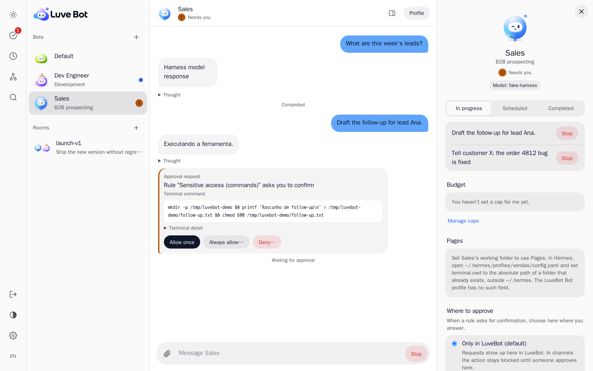
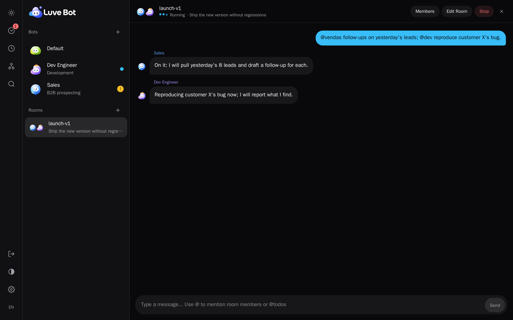
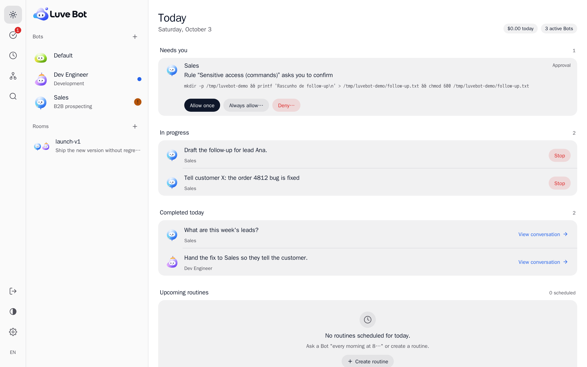
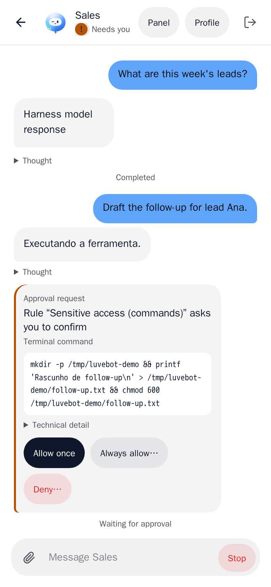

English · [Português](README.pt-BR.md)

# LuveBot

> The Grok Bot, Dots and Cue experience on the Hermes you already run.

LuveBot by Luve AIgency is an open-source mission control for teams of Hermes agents. It is a plugin for the Hermes dashboard that brings conversations, shared rooms, visible work, human approvals and spending controls into one interface on your own server.

**Status: pre-release, under development.** There is no tagged release yet. See [What is in the repository](#what-is-in-the-repository) and the [Roadmap](#roadmap).

## Preview

> **Test setup, not a real account.** These are real captures of LuveBot installed on Hermes in our test environment. The Bots, the room and the messages were made through the app; the Bots' answers come from a test model, which is why some replies read "Harness model response" or stay in Portuguese. The interface is still being refined, and these images will be redone when it is.

<picture>
  <source media="(prefers-color-scheme: dark)" srcset="docs/images/conversation-profile-dark-en.png">
  
</picture>

*Bots are colleagues: approvals and the Bot's profile live inside the conversation.*



*Rooms are group chats: one message with @mentions reaches each Bot, and each one signs its answer.*



*Today: what needs you, what is running and what is done, in one screen.*

<p align="center">
<picture>
  <source media="(prefers-color-scheme: dark)" srcset="docs/images/mobile-conversation-dark-en.png">
  
</picture>
</p>

<p align="center"><em>On a phone, the conversation and its approvals work the same way.</em></p>

## Why LuveBot

- **Rules that really block.** LuveBot enforces rules through a small plugin that Hermes loads in each Bot's profile and that runs before every tool call. Every rule shows an honest seal of what it actually is: a real block, a real approval, guidance only, or broken (the seal contradicts the live state of Hermes). Guidance is never presented as enforcement.
- **A human approves.** No LuveBot code approves anything on its own. An approval is tied to the exact call it was asked for and can be used once. You allow once, deny with a reason, edit or decide in batch. "Always allow" only creates a draft rule that a person must review.
- **Spending caps that pause.** When a Bot hits its cap, LuveBot pauses that Bot's Hermes cron jobs and refuses new runs for it. Raising or removing a cap, or resuming a paused Bot, requires a signed-in session. Caps are not an exact billing ceiling; [SECURITY.md](SECURITY.md) lists the limits. A paused Bot still answers messages on Telegram and its other channels (its Hermes gateway): only LuveBot's own entry points and the Bot's cron jobs are closed.
- **Audited.** Every action with an effect is recorded in LuveBot's own database: who, what, when and from where. The log is append-only and hash-chained, so changes can be detected (tamper-evident, not tamper-proof).
- **Inside the Hermes dashboard, no new port.** LuveBot is a dashboard plugin. It sits behind the dashboard's login, opens no server or port of its own, and keeps API keys and `.env` values on the server; they never reach the browser.

## What it is

LuveBot is the experience and control layer. A Bot maps to a Hermes profile; conversations use Hermes sessions, rooms use Hermes's native Group Chat, routines use Hermes cron, and handoffs use Hermes Kanban. LuveBot is designed to expose those capabilities and add a unified interface, rules, budgets and aggregated auditing.

Hermes remains responsible for the runtime: agents, tools, memory, cron, gateway, native approvals and execution security. LuveBot does not build a runtime, sandbox, tool gateway, secrets vault, wallet or telephone service.

## What is in the repository

Released in v0.1, with tests (the backend against a real Hermes):

- A messenger-style home: Today, the list of Bots with what needs you, and each Bot's profile.
- Creating a Bot from a template, ending with the Bot introducing itself.
- Streaming conversations with tool steps, subagents, approvals inside the conversation, a work panel (Activity, Terminal, Files) and Stop.
- An approval inbox, and rules with seals, drafts and a simulator, enforced by the per-profile rules plugin.
- Activity View as a list and as a Kanban board, routines with their full run history and a test run, and costs with spending caps that pause.
- Rooms on Hermes's native Group Chat with `@` routing to members, handoffs through Hermes Kanban, a team map and search with a command palette (`⌘K`).
- Settings, the Luve theme, an installable PWA, Portuguese and English, and keyboard accessibility.

## Requirements for v0.1

- An existing [Hermes Agent](https://github.com/NousResearch/hermes-agent) installation with its dashboard and an API Server available for each profile you want to operate.
- The Hermes dashboard behind its login (a non-loopback bind with authentication) to decide approvals, loosen rules, raise or remove a cap, or resume a paused Bot. On a local dashboard (loopback) Hermes has no login, so LuveBot shows all of that read-only. Treat every person with dashboard access as a full operator.
- Hermes 2026.9.24: tested with Hermes 2026.9.24; newer releases are expected to work but have not been validated.
- For the Screen tab (experimental): a **Linux** server running Hermes, prepared with **Xvnc and Xfce**. Without that setup the tab explains what is missing.

Hermes profiles are not sandboxes. Read [SECURITY.md](SECURITY.md) for the trust boundaries and the limits of approvals and budgets.

## Installation

LuveBot is a Hermes dashboard plugin. Installing it means putting this repository in Hermes's plugin directory, installing the Luve theme, enabling the plugin and restarting the dashboard. It adds no server and no port.

> **Approvals need a login.** The restart command below starts a local dashboard: `hermes dashboard --no-open` binds 127.0.0.1 (loopback). That is fine to try LuveBot. But Hermes asks for no login on loopback, so LuveBot shows approvals read-only and will not let you decide them, loosen rules, raise or remove a cap, or resume a paused Bot.
>
> To decide approvals, give the dashboard Hermes's password login and bind it outside loopback:
>
> ```sh
> # `python` here is the Python that runs Hermes (see "Install" below for how to find it).
> hermes config set dashboard.basic_auth.username "your-name"
> hermes config set dashboard.basic_auth.password_hash "$(python -c "from plugins.dashboard_auth.basic import hash_password; print(hash_password('your-password'))")"
> hermes config set dashboard.basic_auth.secret "$(python -c "import secrets; print(secrets.token_hex(32))")"
> hermes dashboard --host 0.0.0.0 --no-open
> ```
>
> - Hermes turns the login on only for a non-loopback bind (`--host`). On 127.0.0.1 there is no login, even with `basic_auth` set.
> - Hermes refuses a non-loopback bind with no login configured.
> - The `secret` keeps you signed in across dashboard restarts.
> - Hermes serves plain HTTP. If other machines can reach it, put it behind HTTPS (a reverse proxy or a tunnel).
> - Hermes's OAuth login (`hermes dashboard register`, Nous Portal) also works.

> The commands below clone the official repository, `https://github.com/LucasVenuto/LuveBot.git` (or use a local path to a copy of it). The dashboard bundle (`dashboard/dist/`) is committed, so no build step is needed.

### Prerequisites

- Hermes Agent release **2026.9.24**: tested with Hermes 2026.9.24; newer releases are expected to work but have not been validated. The plugin checks this baseline in its `/health` and reports older releases as unsupported. `hermes --version` shows the release.
- The Hermes dashboard (`hermes dashboard`). LuveBot sits behind its login. Deciding approvals, loosening rules, raising or removing a cap and resuming a paused Bot need the dashboard with a login (see **Approvals need a login** above). On a local dashboard (loopback) they are read-only.
- An API Server enabled for each profile you want to operate as a Bot (`API_SERVER_KEY` in that profile's `.env`). Without it LuveBot loads, but those Bots are reported unavailable.
- `git`, `curl` and a POSIX shell.

### Install

<!-- install-test: install -->
```sh
git clone "https://github.com/LucasVenuto/LuveBot.git" "${HERMES_HOME:-$HOME/.hermes}/plugins/luvebot"
cd "${HERMES_HOME:-$HOME/.hermes}/plugins/luvebot"
# Finds the Python that runs Hermes and checks it before changing anything (see below).
./scripts/install.sh
```

`scripts/install.sh` copies `luve.yaml` to `$HERMES_HOME/dashboard-themes/` and enables the plugin through Hermes's own activation code (`hermes_cli.plugins_cmd`). It does not edit Hermes's files by hand.

It also sets, through Hermes's own config writer, the documented `platform_hints.api_server` override in each Bot's profile so the Bot writes Markdown, which LuveBot renders safely (Hermes otherwise tells API Server agents to write plain text). A profile that already has its own `platform_hints.api_server` is left as it is. Bots created later get it at creation.

It runs that code with the Python that runs your Hermes, found in this order:
1. `HERMES_PYTHON`, if you set it: `HERMES_PYTHON=/path/to/python ./scripts/install.sh`.
2. The interpreter on the first line of the `hermes` command, when that is a Python (a pip or venv install).
3. Otherwise, the `hermes` command itself. The shell launcher that Hermes's installer writes (`#!/bin/sh`) runs a module with its own Python through `hermes --run-module`, the form Hermes uses for the commands it saves ([_launchers.py](https://github.com/NousResearch/hermes-agent/blob/f8489405/hermes_cli/_launchers.py#L73)). An older launcher that lacks it reports its runtime through `hermes --print-runtime-command`, the interface Hermes's own tools use ([_launchers.py](https://github.com/NousResearch/hermes-agent/blob/f8489405/hermes_cli/_launchers.py#L61)).

Before it copies or enables anything, the script checks that this Python really imports `hermes_cli.plugins_cmd`. If no candidate does, it stops with a message, changes nothing, and asks you to set `HERMES_PYTHON`. `HERMES_HOME` defaults to `~/.hermes`. Do not use `hermes plugins enable luvebot`: that command only knows agent plugins and answers "No plugin named 'luvebot'" for a dashboard plugin like this one.

### The rules plugin in every Bot

LuveBot enforces its rules through a small second plugin, `hermes-plugin/` (plugin name `luvebot-hook`), that Hermes loads **per profile**. LuveBot installs and enables it in each Bot's profile with Hermes's own plugin installer when you create a Bot, and, for Bots that already exist, when you ask for it (`POST /bots/{bot}/hook/install`). Two things follow:

- Hermes installs plugins from a **git commit**. Your clone of this repository must be a real git checkout whose `HEAD` contains the `hermes-plugin/` folder; changes you have not committed in that folder are not installed. If you develop in the clone, commit before creating Bots.
- A Bot created after the gateway started needs a short while (about 20 seconds) before the gateway loads its plugin. Until then LuveBot reports the Bot's rules as "waiting for the gateway" and refuses to start work on it; it does not need a restart.

### Restart the dashboard

The dashboard reads plugins at start. Stop it and start it again the way you normally run it; for example:

<!-- install-test: restart -->
```sh
hermes dashboard --stop
hermes dashboard --no-open
```

(`--stop` finds dashboard processes with `ps`; on a minimal image without `procps`, stop the process yourself.)

This starts a local (loopback) dashboard, where approvals are read-only. To decide them, start it with a login instead (see **Approvals need a login** above).

### Check that it works

<!-- install-test: verify -->
```sh
# No session: the plugin refuses. Expect 401.
curl -s -o /dev/null -w '%{http_code}\n' http://127.0.0.1:9119/api/plugins/luvebot/health
```

With a session, in a browser: open the dashboard. LuveBot replaces the home (`/`) and lists your Bots. If you run the dashboard behind its login (a non-loopback bind with authentication), a signed-in tab can also open `/api/plugins/luvebot/health` directly.

On a local dashboard (loopback bind) Hermes asks for no login, so LuveBot cannot tell a person from the machine: it shows approvals read-only and refuses to decide them (`403 loopback_not_human`), along with loosening rules, raising or removing a cap and resuming a paused Bot. To decide approvals, see **Approvals need a login** above.

On a local dashboard (loopback bind) the session is the token Hermes embeds in its own page; this reads `/health` with it:

<!-- install-test: verify2 -->
```sh
TOKEN="$(curl -s http://127.0.0.1:9119/ | sed -n 's/.*__HERMES_SESSION_TOKEN__="\([^"]*\)".*/\1/p')"
curl -s -H "X-Hermes-Session-Token: $TOKEN" http://127.0.0.1:9119/api/plugins/luvebot/health
```

Expect JSON with `"ok": true`, the plugin version and your Hermes release. If `hermes.baseline_ok` is `false`, update Hermes. Treat that token like a password; do not paste it anywhere.

### Phone notifications: the sender's contact

Phone notifications are optional. Apple's and Google's push services require the sender to identify itself with an `https://` address or a `mailto:`, so LuveBot needs one:

- If Hermes has `dashboard.public_url` set to an `https://` address, LuveBot uses it on its own. There is nothing to do.
- Otherwise set `LUVEBOT_PUSH_SUBJECT=mailto:you@your-domain.com` in the environment where the dashboard runs. Use a real domain: not `localhost`, an IP address, or a name ending in `.local`, `.test` and the like. If both exist, `LUVEBOT_PUSH_SUBJECT` is the one used.

Then restart the dashboard (and the gateways, if you run them) and check in **Settings > Notifications > Send a test**. Without a valid contact, that screen says so instead of sending.

On an iPhone, add LuveBot to the Home Screen (Safari, Share, Add to Home Screen), open it from there and turn notifications on from inside that app, not from the Safari tab. That is how the test notification reached a real iPhone.

### Uninstall

<!-- install-test: uninstall -->
```sh
"${HERMES_HOME:-$HOME/.hermes}/plugins/luvebot/scripts/install.sh" --uninstall
```

`--uninstall` disables the plugin through the same Hermes activation code as the install, removes the Luve theme and the plugin directory, and can be repeated (from another copy of the repository, since the first run removes this one). Because the repository is cloned into `plugins/luvebot`, `--uninstall` deletes that entire clone, including any local uncommitted changes; if you develop in it, copy your work out first.

Restart the dashboard afterwards. LuveBot's own data (its audit database and Bot display settings) stays in `$HERMES_HOME/luvebot/`; delete that folder too if you want it gone. Bots are ordinary Hermes profiles and are not removed.

For development checks, see [CONTRIBUTING.md](CONTRIBUTING.md). The installation above is exercised from a clean container by `tests/install/run.sh`.

## Backup and restore

LuveBot keeps its own data in `$HERMES_HOME/luvebot/luvebot.db`, in SQLite's write-ahead-log mode: while it runs you will also see `luvebot.db-wal` and `luvebot.db-shm` next to it. That is normal; leave them alone.

**Never copy, `rsync`, `tar` or let a folder-backup tool (restic, borg, Time Machine, a cloud-sync folder) read `luvebot.db` or the `luvebot` folder while the dashboard or a gateway runs.** A copy of `luvebot.db` alone silently misses everything still in the `-wal` file (the copy opens fine and is simply old), and three files copied at different moments are corrupt. The supported backup is the script below: it copies through SQLite's backup API (consistent while everything runs) and keeps the copy only if `PRAGMA integrity_check` answers `ok`. Its output is one plain file and is safe to copy anywhere. A snapshot of the whole disk or virtual machine taken by your provider is also safe. With everything stopped, copy the three files together.

Keep `$HERMES_HOME` on a local disk. On a network share (NFS, SMB) the write-ahead log is not safe: LuveBot then stays in SQLite's older journal mode and says so in its health report.

```sh
SCRIPT="${HERMES_HOME:-$HOME/.hermes}/plugins/luvebot/scripts/backup_luvebot.py"
python3 "$SCRIPT"                       # safe while everything runs; writes luvebot/backups/luvebot-<UTC time>.db (0600)
python3 "$SCRIPT" --check <backup.db>   # is this backup sound?
```

To restore:
1. Stop the dashboard (`hermes dashboard --stop`) and every gateway (`hermes gateway stop`, and `hermes -p <bot> gateway stop` for each Bot that runs its own).
2. Check the backup: `python3 "$SCRIPT" --check <backup.db>`. Use only one that answers `ok`.
3. Restore: `python3 "$SCRIPT" --restore <backup.db>`. It refuses a bad backup or a database still in use. The current database and its `-journal`, `-wal` and `-shm` files are moved aside together with a `.before-restore-<time>` suffix, never deleted, so no old journal is replayed into the restored file.
4. Start the gateways and the dashboard again.

## Live screen

The Screen tab, in a conversation's work panel, is **experimental**. It shows the Bot's desktop (Hermes Bot Desktop) live. You can watch it, take control and give control back to the Bot.

- It only works on a **Linux** server running Hermes, prepared with **Xvnc and Xfce**. The guide for that preparation is still being tested and is not published yet.
- LuveBot installs nothing on the server. Whoever runs the server installs the packages.
- Without that setup, the tab says what is missing: not a Linux server, missing packages (with the list and the install command Hermes suggests), not enough free memory, or a screen inside the terminal sandbox.
- Giving control back needs the dashboard with a login (see **Approvals need a login** above).

## Roadmap

### v0.1 — released

Published and accepted. It includes everything listed in **What is in the repository**, plus pausing and resuming a Bot by hand from its profile. The live Screen tab ships as experimental, and its server setup guide is still being tested (see **Live screen**). Tagged releases with a published compatibility range come later; the tested Hermes version is in **Requirements for v0.1**.

### v0.2 — ready for acceptance, not released yet

Seeing what the Bots make:
- Open images and HTML pages from a Bot's files without downloading them. Pages open isolated: no scripts, nothing loaded from the internet, no access to your account, and the links inside them do nothing. SVG images are shown as pictures only. **Where:** Files, in a conversation's work panel.
- Files in rooms, both ways: send a file to the Bots you mention, and download what a Bot delivers. **Where:** in a room.
- Pages: edit a Bot's pages with a toolbar and keyboard shortcuts (opening and closing a page never changes a byte), and an optional switch, **Review before saving**, that asks for your approval when a Bot writes a page, showing what it wants to write. It covers only the file tools of Hermes: a Bot that writes a page through the terminal is not stopped, and the screen says so. To replace a page that already exists, Hermes itself only lets a Bot write it if the Bot read the whole page first; if not, it refuses even after you approve (the page stays as it was) and the Bot reads it and asks again, so you may see a second request. **Where:** a Bot's Pages.

Control:
- Skills per Bot: see which Bot can use which skill, and turn skills on or off through Hermes. Turning one on needs a login. **Where:** a Bot's Skills, and Settings › every Bot's skills.
- Choose how long a Bot waits for your approval (5 minutes to 4 hours; new Bots wait 1 hour). Silence still means no. **Where:** Settings, and the side panel of a Bot.
- Editable memory: see, edit and delete what each Bot remembers, item by item. **Where:** a Bot's Memory.
- Automatic pause after a number of days without you opening LuveBot. It is off by default, it pauses only routines, never overrides a spending cap, and only you resume them. **Where:** Settings (the Inactivity card).
- Pin, hide and reorder Bots in the sidebar. **Where:** the Bots list in the sidebar.
- **Free mode** per Bot: LuveBot stops asking that Bot for approval. Block and Handback rules still stop it and Hermes's own prompts still apply. A signed-in person turns it on, it is audited, and a screen lists what it let through. **Where:** a Bot's Rules (a chip marks it in the list and in the conversation).
- **Rule conditions:** a rule can depend on the file a Bot writes (`write_file` and `patch`) or on who receives a task or a routine's output (`kanban_create` and routines). Each rule says what it cannot see (the terminal, code execution, other tools). **Where:** a Bot's Rules.
- The rules simulator also shows what Hermes's own gate would do with a command. **Where:** a Bot's Rules.

Voice:
- Radio: hold to talk; your words become a normal message, and the reply can be read aloud. **Where:** the buttons in a conversation's message box.
- Call: talk in real time with a Bot (needs an OpenAI key, about US$ 0.05 per minute, counted on the spending cap). Voice never approves anything. **Where:** the same buttons.

Work and conversation:
- Proactive research: a routine in which the Bot searches the web on its own and delivers a summary. It can only read. **Where:** Routines.
- Threads and reactions in conversations. Reactions are kept by Hermes itself, one per message for everybody; in a LuveBot conversation the Bot is not told about them. **Where:** on any message of a conversation.
- Suggestions: a draft rule when you keep approving the same action, and a Bot can suggest creating a new Bot. Nothing is applied without you. **Where:** a Bot's Rules (rules), the conversation and rooms (Bots).
- A timeline with a lane per Bot, and a heatmap of Bots by hour of the day. **Where:** Activity (the heatmap is under Hours).
- Phone notifications from the installed app. The lock screen shows only which Bot needs you, never what it wants to do. **Where:** Settings › Notifications.
- "Needs you" in Today also shows what a Bot waits on outside LuveBot (a question, a password in the terminal, an approval in another channel). View only. **Where:** Today.
- A projection of the month's spending, and the plan quota when your Hermes reports it. **Where:** Costs.
- Faster: a new conversation's first message takes two round trips instead of four, and LuveBot's database runs in write-ahead-log mode (see **Backup and restore**).

Create your Luve: a studio to build your own character from the Luve family (shape, color, material, accessory) with a live 3D preview, a PNG download, and use as a Bot's face or your own ("My Luve" in Settings). **Where:** Bot profile › 1. Identity, and Settings › My Luve.

#### What has not been proven against a real Hermes

LuveBot's tests run its backend against a real Hermes in a test container (Hermes 2026.9.24) and, since 2026-10-30, natively against Hermes v0.22.5, the current stable release. Not everything in v0.2 has been through that, and you should know which parts:
- **Run against a real Hermes and passing:** On Hermes 2026.9.24 in a test container: everything in v0.1, opening files, skills, files in rooms, the approval wait time, the voice routes (with a fake model provider), memory, and pin and order of Bots. Natively on **Hermes v0.22.5, the current stable release (batches run on 2026-10-30)**: the health report and the version banner, error naming, the restart request, no new port and no access without a session; the database in write-ahead-log mode with the dashboard and a gateway writing together; the rules plugin (hook 0.8.0), Free mode and the choice of where to approve; **approving and denying through Hermes's session controls, with the request tied to the exact call it came from**; a conversation from another channel and "continue in a copy"; the first message creating the conversation; threads and reactions; the rules API, **rule conditions by file and by recipient, the whole flow: a Bot stopped or left waiting by them, with a negative control (a call outside the condition goes through untouched)** and suggestions of rules; **the simulator's view of Hermes's own gate** (two Bots never mix, and "Always allow" reaches the configuration on disk); the whole Review-before-saving flow with a Bot really writing (the request with the preview and the diff, nothing written while it waits, approving writes exactly what was proposed, "the page changed" refused without deciding, and denying writes nothing); editing a routine's schedule; the inactivity pause (the setting, which only a person turns off or makes longer, with opening LuveBot resuming nothing; and the pause firing after its deadline through the running watcher and the real cron, with the days moved in LuveBot's own record instead of waited for, and "Resume" leaving a Bot the spending cap paused alone); the proactive research routine; the timeline and the hours heat map; the month projection and the plan quota; the notification routes on the server; the waiting list behind "Needs you" and the warning outside LuveBot when a Bot asks a question; whether a Bot can ask at all (the answer the Bot profile uses agrees with a Bot really asking or not, also with no tool list in its configuration); a Bot's question answered from the conversation (a question with options: an option it did not offer is refused, with no login nothing is sent, the right one resumes the run and repeating it is refused, and the attempt is audited), and one with no options answered by typing (an empty, non-text or too-long answer is refused with nothing sent, a machine in loopback is refused, and the text you write is never stored by LuveBot); a run Hermes loses track of (a run held by an approval becomes "unknown"; only a person with a login resolves it, a wrong generation is refused, the attempt is audited and a second try is refused) and the queue behind it (a turn accepted while another one runs waits, keeps waiting if the front run is lost, and runs exactly once after it is resolved); a turn Hermes accepted and kept queued while its owner restarts (it says "queued, do not send it again", runs once on the next owner, and sending again after the restart does not run it twice) and a request that arrives while the gateway drains (answered as "try again in a few seconds", not as a breakage); the reason you give when you deny, reaching the Bot even after its final answer and told as delivered only with proof; the Radio and the server side of the Call with fake speech providers (the eight routes, the spending cap on both, the minutes billed on the voice line, a lost call closed and billed by the sweeper, and voice never approving anything); item-by-item memory; and "My Luve" with the mascots. 
- **Not yet run against a real Hermes:** the "this Bot cannot ask you questions" line on screen (the answer behind it is proven), the same answer staying absent on a real Hermes without session controls (v0.22.2 or older; so far only simulated inside the process), a gateway restarting on a real installation right after the rules plugin was installed (the test exists and needs a Linux container or an installation made by Hermes's own installer; see the update steps), and the real voice providers (the real audio path of the Call and real speech-to-text and text-to-speech services, with their real cost).
- **Tried on a real iPhone:** the test notification (Settings › Notifications › Send a test) arrived, with the app added to the Home Screen and turned on from inside it. Notifications caused by a real request from a Bot are not confirmed on a phone yet.
- **Never tried on a real phone or in Safari:** the HTML and SVG viewer in Safari, the page editor and the 3D preview on a phone.
- The live Screen tab is still experimental.

Read these as "ready to try", not "known to work". If something here fails on your server, tell us what the screen said.

### v0.3 — being tested, not released yet

Control:
- Change a Bot's model from its profile. It applies from the next message, also in conversations that are already open, and a model that may cost a lot asks you to confirm. Helper tasks (summaries and the like) keep the previous provider until you change them in Hermes, and the screen says so. The address and the key of a provider are never changed here. **Where:** Bot profile › 3. Model › Change, then Apply.
- Your own image as a Bot's face (PNG, JPEG or WebP, up to 25 MB; on a phone you can take a photo on the spot). The image stays on your server and is part of LuveBot's backup; "Remove image" deletes it, and an older backup still keeps it. **Where:** the Luve studio (Bot profile › 1. Identity, and Settings › My Luve).
- Teach a Bot a skill by showing it: the Bot writes a draft in the same conversation (it costs one turn of the Bot, inside its spending cap), you read all of it and create it. The skill is created **off** and only counts once you turn it on. You can also edit an existing skill: you read the change before saving, and a skill that comes from somewhere else, or that holds text LuveBot hides, is refused and sent to Hermes. **Where:** "Save as a skill" in a conversation's menu; Edit on a Bot's skills page.
- "Always allow" says "not saved" when the draft was not saved, instead of looking as if it had. It still only creates a draft rule that you review and turn on. **Where:** Approvals.

Work and conversation:
- Skip a question a Bot asks you. **Where:** the question in the conversation.
- Routine suggestions from Hermes: Create paused, Create and start, or Dismiss. One that LuveBot cannot create safely says why and tells you to accept it in Hermes. **Where:** Routines and Today ("Suggestion from Hermes").
- Evidence card: an optional switch adds a short text to the Bot's instructions (saved only when you click Save; it applies to new conversations). When the Bot then ends an answer with an evidence block (facts, assumptions, what was done, what awaits approval, open questions), the conversation shows it as a card marked "Written by the Bot. LuveBot did not check it.", with the number of requests from that conversation waiting in Approvals. It is text only. **Where:** Bot profile › 2. Instructions ("Ask for evidence in important answers"); the card is in the conversation.
- Phone notifications also when a Bot waits on you outside the browser (a question, a password, an approval on another channel), with "Send a test" for each device and a clear message when no contact is set up (see [Phone notifications](#phone-notifications-the-senders-contact)). **Where:** Settings › Notifications.
- A note "Guidance sent to the Bot" in the conversation: when you deny a request with a reason, the reason reaches the Bot inside its turn and shows as a note when you reopen the conversation. **Where:** the direct conversation, on reopening.
- The work panel opens as a drawer on a narrow window.
- On a Hermes version LuveBot has not been tested with, Settings shows one calm line instead of a banner. Hermes v0.22.5 is the tested release.

Safer:
- Only a person with a login counts as a person for actions that need one. The deployment token, or a machine on loopback, never does.
- Rule matching is harder to fool: numeric forms of an IP address, percent-encoded text, a trailing dot, ideographic dots and invisible characters are read as what they stand for, and an allow rule cannot name letters such as ß and ς, whose upper and lower case do not match one to one.
- Hidden characters in text from a Bot or a page are drawn as `[U+XXXX]` instead of staying invisible.
- The summary of a page is computed in time proportional to its size.

#### What has not been proven (v0.3)

v0.3 is being tested. It passes LuveBot's own tests; the list of what has been run against a real Hermes will be written when v0.3 is released. Until then, read each item above as built, not as known to work. Little of v0.3 has been tried on a real phone or in Safari: the test notification reached a real iPhone, with the app added to the Home Screen and turned on from inside it, but notifications caused by a real question from a Bot, taking a photo for a face and the work panel as a drawer are not confirmed. Everything that v0.2 lists as not proven still is, and the live Screen tab is still experimental.

Later:
- Stopping a run for real, once Hermes offers a way to.
- The live Screen tab leaving experimental.

## Contributing and governance

See [CONTRIBUTING.md](CONTRIBUTING.md), the [Code of Conduct](CODE_OF_CONDUCT.md) and [SECURITY.md](SECURITY.md). The contribution sign-off proposal is pending maintainer confirmation; the conduct contact is still TBD. Report vulnerabilities privately through [GitHub security advisories](https://github.com/LucasVenuto/LuveBot/security/advisories/new).

LuveBot's own code is [MIT licensed](LICENSE), Copyright (c) 2026 Luve AIgency. Hermes Agent is by Nous Research and uses MIT. The planned unmodified noVNC component uses MPL-2.0 with separately licensed files. See [NOTICE](NOTICE) and [THIRD_PARTY_LICENSES.md](THIRD_PARTY_LICENSES.md) for attribution and distribution details.

## Trademarks

Grok, Grok Bot, Dots, Cue, Hermes, Hermes Agent, Nous Research, noVNC and the other product and company names mentioned in this repository are trademarks of their respective owners. LuveBot is not affiliated with, sponsored by or endorsed by any of them. These names are used only to describe inspiration and compatibility. No code, artwork or trademark of theirs is included in this repository, except the unmodified third-party components listed in the NOTICE (noVNC).
