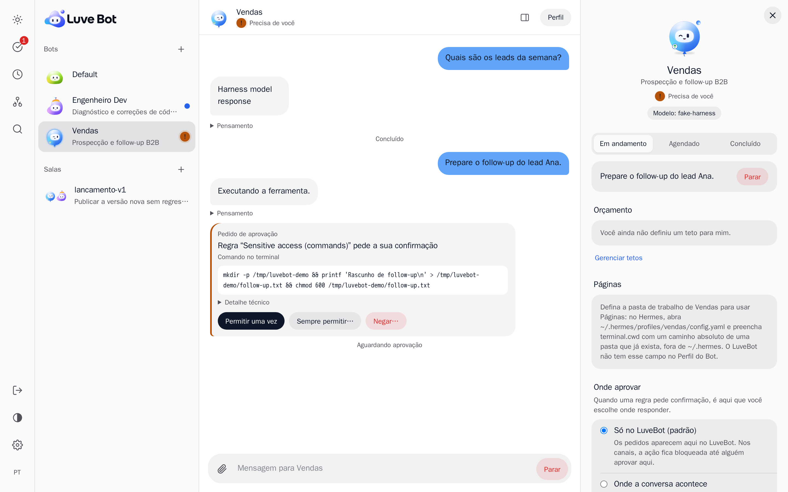
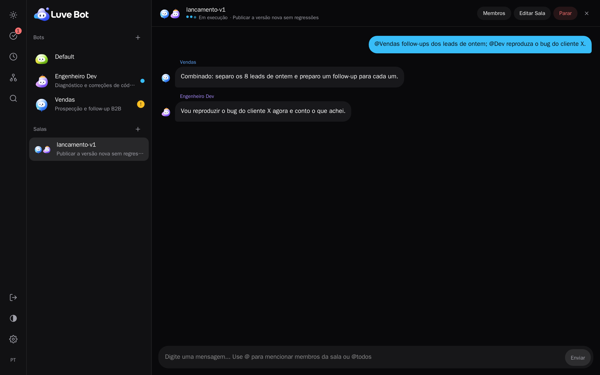
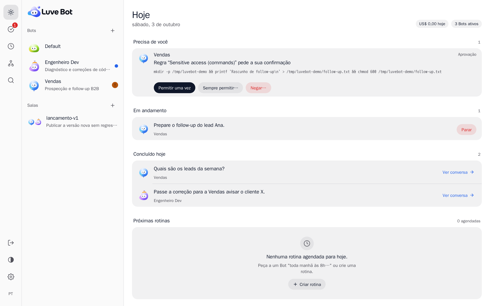
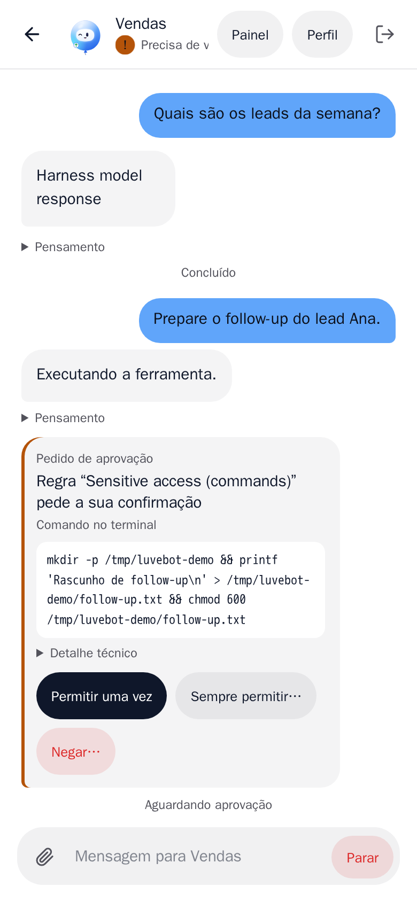

Português · [English](README.md)

# LuveBot

> A experiência do Grok Bot, do Dots e do Cue no Hermes que você já roda.

O LuveBot, da Luve AIgency, é um mission control open-source para times de agentes Hermes. É um plugin do dashboard do Hermes que reúne conversas, salas compartilhadas, trabalho visível, aprovações humanas e controle de gastos numa só interface, no seu próprio servidor.

**Status: pré-lançamento, em desenvolvimento.** Ainda não há versão publicada. Veja [O que já está no repositório](#o-que-já-está-no-repositório) e o [Roteiro](#roteiro).

## Prévia

> **Ambiente de teste, não uma conta real.** São capturas reais do LuveBot instalado no Hermes do nosso ambiente de teste. Os Bots, a sala e as mensagens foram criados pelo próprio app; as respostas dos Bots vêm de um modelo de teste, por isso algumas dizem "Harness model response". A interface ainda está sendo refinada, e as imagens serão refeitas quando estiver pronta.

<picture>
  <source media="(prefers-color-scheme: dark)" srcset="docs/images/conversation-profile-dark-pt.png">
  
</picture>

*Bots são colegas: as aprovações e o perfil do Bot ficam dentro da conversa.*



*Salas são chats em grupo: uma mensagem com @menções chega a cada Bot, e cada um assina a sua resposta.*



*Hoje: o que precisa de você, o que está rodando e o que terminou, numa tela só.*

<p align="center">
<picture>
  <source media="(prefers-color-scheme: dark)" srcset="docs/images/mobile-conversation-dark-pt.png">
  
</picture>
</p>

<p align="center"><em>No celular, a conversa e as aprovações funcionam do mesmo jeito.</em></p>

## Por que o LuveBot

- **Regras que bloqueiam de verdade.** O LuveBot aplica as regras por meio de um pequeno plugin que o Hermes carrega no perfil de cada Bot e que roda antes de cada chamada de ferramenta. Toda regra mostra um selo honesto do que ela é de fato: bloqueio real, aprovação real, só orientação, ou quebrada (o selo contradiz o estado vivo do Hermes). Orientação nunca é apresentada como bloqueio.
- **Quem aprova é uma pessoa.** Nenhum código do LuveBot aprova nada sozinho. A aprovação fica presa à chamada exata para a qual foi pedida e só vale uma vez. Você permite uma vez, nega com motivo, edita ou decide em lote. "Sempre permitir" só cria uma regra em rascunho, que uma pessoa precisa revisar.
- **Teto de gasto que pausa.** Quando um Bot estoura o teto, o LuveBot pausa os cron jobs desse Bot no Hermes e recusa novos runs dele. Subir ou remover um teto, ou retomar um Bot pausado, exige sessão com login. O teto não é um limite exato de cobrança; o [SECURITY.md](SECURITY.md) lista os limites. Um Bot pausado ainda responde mensagens no Telegram e nos outros canais (o gateway do Hermes): só as entradas do próprio LuveBot e os cron jobs do Bot ficam fechados.
- **Auditado.** Toda ação com efeito fica registrada no banco do próprio LuveBot: quem, o quê, quando e de onde. O registro só aceita inclusão e é encadeado por hash, então alterações podem ser detectadas (evidencia adulteração, não impede).
- **Dentro do dashboard do Hermes, sem porta nova.** O LuveBot é um plugin do dashboard. Fica atrás do login do dashboard, não abre servidor nem porta própria, e mantém as chaves de API e os valores do `.env` no servidor; eles nunca chegam ao navegador.

## O que é

O LuveBot é a camada de experiência e controle. Um Bot corresponde a um perfil do Hermes; as conversas usam sessões do Hermes, as salas usam o Group Chat nativo do Hermes, as rotinas usam o cron do Hermes e os handoffs usam o Kanban do Hermes. O LuveBot expõe essas capacidades e acrescenta uma interface unificada, regras, orçamentos e auditoria agregada.

O Hermes continua responsável pelo runtime: agentes, ferramentas, memória, cron, gateway, aprovações nativas e segurança de execução. O LuveBot não constrói runtime, sandbox, gateway de ferramentas, cofre de segredos, carteira nem serviço de telefone.

## O que já está no repositório

Publicado na v0.1, com testes (o backend contra um Hermes real):

- Uma home no estilo de mensageiro: Hoje, a lista de Bots com o que precisa de você, e o perfil de cada Bot.
- Criar um Bot a partir de um template, terminando com o Bot se apresentando.
- Conversas com streaming, passos de ferramenta, subagentes, aprovações dentro da conversa, um painel de trabalho (Atividade, Terminal, Arquivos) e Parar.
- Uma caixa de aprovações, e regras com selos, rascunhos e simulador, aplicadas pelo plugin de regras de cada perfil.
- Activity View em lista e em quadro Kanban, rotinas com o histórico completo de execuções e execução de teste, e custos com tetos de gasto que pausam.
- Salas sobre o Group Chat nativo do Hermes com roteamento por `@` para os membros, handoffs pelo Kanban do Hermes, mapa do time e busca com paleta de comandos (`⌘K`).
- Configurações, o tema Luve, PWA instalável, português e inglês, e acessibilidade por teclado.

## Requisitos da v0.1

- Uma instalação existente do [Hermes Agent](https://github.com/NousResearch/hermes-agent) com o dashboard e um API Server disponível para cada perfil que você quer operar.
- O dashboard do Hermes atrás do login dele (bind fora do loopback, com autenticação) para decidir aprovações, afrouxar regras, subir ou remover um teto e retomar um Bot pausado. Num dashboard local (loopback) o Hermes não tem login, então o LuveBot mostra tudo isso só para leitura. Trate toda pessoa com acesso ao dashboard como operador com acesso total.
- Hermes 2026.9.24: testado com o Hermes 2026.9.24; releases mais novas devem funcionar, mas ainda não foram validadas.
- Para a aba Tela (experimental): um servidor **Linux** rodando o Hermes, preparado com **Xvnc e Xfce**. Sem esse ambiente, a aba explica o que falta.

Perfis do Hermes não são sandboxes. Leia o [SECURITY.md](SECURITY.md) para entender as fronteiras de confiança e os limites das aprovações e dos orçamentos.

## Instalação

O LuveBot é um plugin do dashboard do Hermes. Instalar significa colocar este repositório na pasta de plugins do Hermes, instalar o tema Luve, ativar o plugin e reiniciar o dashboard. Ele não acrescenta servidor nem porta.

> **Aprovar exige login.** O comando de reinício abaixo sobe um dashboard local: `hermes dashboard --no-open` escuta em 127.0.0.1 (loopback). Serve para conhecer o LuveBot. Mas no loopback o Hermes não pede login, então o LuveBot mostra as aprovações só para leitura e não deixa decidi-las, afrouxar regras, subir ou remover um teto nem retomar um Bot pausado.
>
> Para decidir aprovações, ligue o login por senha do Hermes e suba o dashboard fora do loopback:
>
> ```sh
> # Aqui `python` é o Python que roda o Hermes (veja em "Instalar" como achá-lo).
> hermes config set dashboard.basic_auth.username "seu-nome"
> hermes config set dashboard.basic_auth.password_hash "$(python -c "from plugins.dashboard_auth.basic import hash_password; print(hash_password('sua-senha'))")"
> hermes config set dashboard.basic_auth.secret "$(python -c "import secrets; print(secrets.token_hex(32))")"
> hermes dashboard --host 0.0.0.0 --no-open
> ```
>
> - O Hermes só liga o login com bind fora do loopback (`--host`). Em 127.0.0.1 não há login, mesmo com `basic_auth` configurado.
> - O Hermes recusa bind fora do loopback sem login configurado.
> - O `secret` mantém você logado quando o dashboard reinicia.
> - O Hermes serve HTTP simples. Se outras máquinas alcançam o dashboard, coloque-o atrás de HTTPS (proxy reverso ou túnel).
> - O login OAuth do Hermes (`hermes dashboard register`, Nous Portal) também serve.

> Os comandos abaixo clonam o repositório oficial, `https://github.com/LucasVenuto/LuveBot.git` (ou use o caminho local de uma cópia dele). O bundle do dashboard (`dashboard/dist/`) vem commitado, então não é preciso build.

### Pré-requisitos

- Hermes Agent na release **2026.9.24**: testado com o Hermes 2026.9.24; releases mais novas devem funcionar, mas ainda não foram validadas. O plugin confere essa base no `/health` e mostra releases anteriores como não suportadas. `hermes --version` mostra a release.
- O dashboard do Hermes (`hermes dashboard`). O LuveBot fica atrás do login dele. Decidir aprovações, afrouxar regras, subir ou remover um teto e retomar um Bot pausado exigem o dashboard com login (veja **Aprovar exige login** acima). Num dashboard local (loopback) isso fica só para leitura.
- Um API Server ativado em cada perfil que você quer operar como Bot (`API_SERVER_KEY` no `.env` desse perfil). Sem ele o LuveBot carrega, mas esses Bots aparecem como indisponíveis.
- `git`, `curl` e um shell POSIX.

### Instalar

```sh
git clone "https://github.com/LucasVenuto/LuveBot.git" "${HERMES_HOME:-$HOME/.hermes}/plugins/luvebot"
cd "${HERMES_HOME:-$HOME/.hermes}/plugins/luvebot"
# Encontra o Python que roda o Hermes e confere antes de mudar qualquer coisa (veja abaixo).
./scripts/install.sh
```

O `scripts/install.sh` copia o `luve.yaml` para `$HERMES_HOME/dashboard-themes/` e ativa o plugin pelo próprio código de ativação do Hermes (`hermes_cli.plugins_cmd`). Ele não edita arquivos do Hermes à mão.

Ele também grava, pelo escritor de configuração do próprio Hermes, o ajuste documentado `platform_hints.api_server` no perfil de cada Bot, para o Bot escrever em Markdown, que o LuveBot mostra com segurança (sem isso o Hermes manda o agente do API Server escrever texto puro). Um perfil que já tenha o seu próprio `platform_hints.api_server` fica como está. Bots criados depois já nascem com ele.

Ele roda esse código com o Python que roda o seu Hermes, procurado nesta ordem:
1. O `HERMES_PYTHON`, se você definir: `HERMES_PYTHON=/caminho/do/python ./scripts/install.sh`.
2. O interpretador da primeira linha do comando `hermes`, quando ele é um Python (instalação por pip ou venv).
3. Senão, o próprio comando `hermes`. O launcher em shell que o instalador do Hermes grava (`#!/bin/sh`) roda um módulo com o próprio Python por `hermes --run-module`, a forma que o Hermes usa nos comandos que ele grava ([_launchers.py](https://github.com/NousResearch/hermes-agent/blob/f8489405/hermes_cli/_launchers.py#L73)). Um launcher mais antigo, sem essa opção, informa o runtime por `hermes --print-runtime-command`, a interface que as ferramentas do Hermes usam ([_launchers.py](https://github.com/NousResearch/hermes-agent/blob/f8489405/hermes_cli/_launchers.py#L61)).

Antes de copiar ou ativar qualquer coisa, o script confere se esse Python importa de fato o `hermes_cli.plugins_cmd`. Se nenhum candidato importa, ele para com uma mensagem, não muda nada e pede que você defina o `HERMES_PYTHON`. `HERMES_HOME` é `~/.hermes` por padrão. Não use `hermes plugins enable luvebot`: esse comando só conhece plugins de agente e responde "No plugin named 'luvebot'" para um plugin de dashboard como este.

### O plugin de regras em cada Bot

O LuveBot aplica as regras por meio de um segundo plugin pequeno, `hermes-plugin/` (nome do plugin `luvebot-hook`), que o Hermes carrega **por perfil**. O LuveBot instala e ativa esse plugin no perfil de cada Bot com o instalador de plugins do próprio Hermes quando você cria um Bot e, para Bots que já existem, quando você pede (`POST /bots/{bot}/hook/install`). Disso decorrem duas coisas:

- O Hermes instala plugins a partir de um **commit do git**. O seu clone deste repositório precisa ser um checkout git de verdade cujo `HEAD` contenha a pasta `hermes-plugin/`; mudanças não commitadas nessa pasta não são instaladas. Se você desenvolve no clone, commite antes de criar Bots.
- Um Bot criado depois que o gateway subiu precisa de um tempinho (cerca de 20 segundos) até o gateway carregar o plugin dele. Até lá, o LuveBot mostra as regras do Bot como "aguardando o gateway" e se recusa a iniciar trabalho nele; não é preciso reiniciar.

### Reiniciar o dashboard

O dashboard lê os plugins ao iniciar. Pare e inicie de novo do jeito que você costuma rodar; por exemplo:

```sh
hermes dashboard --stop
hermes dashboard --no-open
```

(O `--stop` encontra os processos do dashboard com `ps`; numa imagem mínima sem `procps`, pare o processo você mesmo.)

Isto sobe um dashboard local (loopback), onde as aprovações ficam só para leitura. Para decidi-las, suba com login (veja **Aprovar exige login** acima).

### Conferir se funcionou

```sh
# No session: the plugin refuses. Expect 401.
curl -s -o /dev/null -w '%{http_code}\n' http://127.0.0.1:9119/api/plugins/luvebot/health
```

Com sessão, no navegador: abra o dashboard. O LuveBot substitui a home (`/`) e lista os seus Bots. Se você roda o dashboard atrás do login (bind fora do loopback, com autenticação), uma aba com login também consegue abrir `/api/plugins/luvebot/health` diretamente.

Num dashboard local (bind em loopback) o Hermes não pede login, então o LuveBot não distingue uma pessoa da máquina: mostra as aprovações só para leitura e recusa decidi-las (`403 loopback_not_human`), assim como afrouxar regras, subir ou remover um teto e retomar um Bot pausado. Para decidir aprovações, veja **Aprovar exige login** acima.

Num dashboard local (bind em loopback), a sessão é o token que o Hermes embute na própria página; isto lê o `/health` com ele:

```sh
TOKEN="$(curl -s http://127.0.0.1:9119/ | sed -n 's/.*__HERMES_SESSION_TOKEN__="\([^"]*\)".*/\1/p')"
curl -s -H "X-Hermes-Session-Token: $TOKEN" http://127.0.0.1:9119/api/plugins/luvebot/health
```

Espere um JSON com `"ok": true`, a versão do plugin e a sua release do Hermes. Se `hermes.baseline_ok` vier `false`, atualize o Hermes. Trate esse token como uma senha; não cole em lugar nenhum.

### Notificações no celular: o contato do remetente

As notificações no celular são opcionais. Os serviços de push da Apple e do Google exigem que o remetente se identifique com um endereço `https://` ou um `mailto:`, então o LuveBot precisa de um:

- Se o Hermes tem `dashboard.public_url` com um endereço `https://`, o LuveBot o usa sozinho. Não há nada a fazer.
- Senão, defina `LUVEBOT_PUSH_SUBJECT=mailto:voce@seu-dominio.com` no ambiente em que o dashboard roda. Use um domínio real: nada de `localhost`, endereço IP ou nome terminado em `.local`, `.test` e parecidos. Se os dois existirem, vale o `LUVEBOT_PUSH_SUBJECT`.

Depois reinicie o dashboard (e os gateways, se você os roda) e confira em **Configurações > Notificações > Enviar teste**. Sem um contato válido, essa tela avisa em vez de enviar.

No iPhone, adicione o LuveBot à Tela de Início (Safari, Compartilhar, Adicionar à Tela de Início), abra-o por lá e ligue as notificações de dentro desse app, não da aba do Safari. Foi assim que a notificação de teste chegou a um iPhone de verdade.

### Desinstalar

```sh
"${HERMES_HOME:-$HOME/.hermes}/plugins/luvebot/scripts/install.sh" --uninstall
```

O `--uninstall` desativa o plugin pelo mesmo código de ativação do Hermes usado na instalação, remove o tema Luve e a pasta do plugin, e pode ser repetido (a partir de outra cópia do repositório, já que a primeira execução remove esta). Como o repositório é clonado em `plugins/luvebot`, o `--uninstall` apaga o clone inteiro, inclusive mudanças locais não commitadas; se você desenvolve nele, copie o seu trabalho antes.

Reinicie o dashboard depois. Os dados do próprio LuveBot (o banco de auditoria e as configurações de exibição dos Bots) ficam em `$HERMES_HOME/luvebot/`; apague essa pasta também se quiser que sumam. Os Bots são perfis comuns do Hermes e não são removidos.

Para as verificações de desenvolvimento, veja o [CONTRIBUTING.md](CONTRIBUTING.md). A instalação acima é exercitada a partir de um container limpo pelo `tests/install/run.sh`.

## Backup e restauração

O LuveBot guarda os próprios dados em `$HERMES_HOME/luvebot/luvebot.db`, no modo de registro de escrita antecipada (WAL) do SQLite: com ele no ar você também vê `luvebot.db-wal` e `luvebot.db-shm` ao lado. Isso é normal; não mexa neles.

**Nunca copie, use `rsync` ou `tar`, nem deixe uma ferramenta de backup de pasta (restic, borg, Time Machine, pasta sincronizada na nuvem) ler o `luvebot.db` ou a pasta `luvebot` com o dashboard ou um gateway no ar.** Uma cópia só do `luvebot.db` perde em silêncio tudo o que ainda está no `-wal` (a cópia abre normalmente e é só antiga), e três arquivos copiados em momentos diferentes ficam corrompidos. O backup suportado é o script abaixo: ele copia pela API de backup do SQLite (consistente com tudo no ar) e só guarda a cópia se o `PRAGMA integrity_check` responder `ok`. O resultado é um arquivo comum e pode ser copiado para qualquer lugar. Um snapshot do disco ou da máquina virtual feito pelo seu provedor também é seguro. Com tudo parado, copie os três arquivos juntos.

Mantenha o `$HERMES_HOME` em disco local. Em compartilhamento de rede (NFS, SMB) o WAL não é seguro: o LuveBot então fica no modo de journal mais antigo do SQLite e diz isso no relatório de saúde.

```sh
SCRIPT="${HERMES_HOME:-$HOME/.hermes}/plugins/luvebot/scripts/backup_luvebot.py"
python3 "$SCRIPT"                       # seguro com tudo no ar; grava luvebot/backups/luvebot-<hora UTC>.db (0600)
python3 "$SCRIPT" --check <backup.db>   # este backup está bom?
```

Para restaurar:
1. Pare o dashboard (`hermes dashboard --stop`) e todos os gateways (`hermes gateway stop`, e `hermes -p <bot> gateway stop` para cada Bot com gateway próprio).
2. Confira o backup: `python3 "$SCRIPT" --check <backup.db>`. Use só um que responda `ok`.
3. Restaure: `python3 "$SCRIPT" --restore <backup.db>`. Ele recusa um backup ruim ou um banco ainda em uso. O banco atual e os arquivos `-journal`, `-wal` e `-shm` vão juntos para o lado com o sufixo `.before-restore-<hora>`, nunca apagados, então nenhum journal antigo é reaplicado no arquivo restaurado.
4. Suba de novo os gateways e o dashboard.

## Tela ao vivo

A aba Tela, no painel de trabalho da conversa, é **experimental**. Ela mostra ao vivo o desktop do Bot (o Bot Desktop do Hermes). Você pode assistir, assumir o controle e devolver o controle ao Bot.

- Só funciona num servidor **Linux** rodando o Hermes, preparado com **Xvnc e Xfce**. O roteiro dessa preparação ainda está em teste e não foi publicado.
- O LuveBot não instala nada no servidor. Quem administra o servidor instala os pacotes.
- Sem esse ambiente, a aba diz o que falta: o servidor não é Linux, faltam pacotes (com a lista e o comando de instalação sugerido pelo Hermes), falta memória livre, ou a tela está no sandbox do terminal.
- Devolver o controle exige o dashboard com login (veja **Aprovar exige login** acima).

## Roteiro

### v0.1, publicada

Publicada e aceita. Inclui tudo o que está em **O que já está no repositório**, mais pausar e retomar um Bot manualmente pelo perfil. A aba Tela ao vivo sai como experimental, e o roteiro de preparação do servidor ainda está em teste (veja **Tela ao vivo**). Releases com tag e faixa de compatibilidade declarada vêm depois; a versão do Hermes testada está em **Requisitos da v0.1**.

### v0.2, pronta para aceite, ainda não publicada

Ver o que os Bots fazem:
- Abrir imagens e páginas HTML dos arquivos de um Bot sem baixar. As páginas abrem isoladas: sem scripts, sem carregar nada da internet, sem acesso à sua conta, e os links dentro delas não fazem nada. Imagens SVG aparecem só como figura. **Onde:** Arquivos, no painel de trabalho de uma conversa.
- Arquivos na sala, nos dois sentidos: envie um arquivo para os Bots que você mencionar e baixe o que um Bot entregar. **Onde:** numa sala.
- Páginas: edite as páginas de um Bot com uma barra de botões e atalhos de teclado (abrir e fechar uma página nunca muda um byte), e um interruptor opcional, **Revisar antes de salvar**, que pede a sua aprovação quando um Bot grava uma página, mostrando o que ele quer gravar. Ele cobre só as ferramentas de arquivo do Hermes: um Bot que grava a página pelo terminal não é parado, e a tela diz isso. Para trocar uma página que já existe, o próprio Hermes só deixa o Bot gravar se ele leu a página inteira antes; se não leu, ele recusa mesmo depois da sua aprovação (a página fica como estava) e o Bot lê e pede de novo, então você pode ver um segundo pedido. **Onde:** as Páginas de um Bot.

Controle:
- Skills por Bot: veja qual Bot pode usar qual skill e ligue ou desligue pelo Hermes. Ligar exige login. **Onde:** as Skills de um Bot, e Configurações › Skills de todos os Bots.
- Escolha quanto tempo um Bot espera a sua aprovação (de 5 minutos a 4 horas; Bots novos esperam 1 hora). O silêncio continua sendo não. **Onde:** Configurações, e o painel lateral de um Bot.
- Memória editável: veja, edite e apague o que cada Bot lembra, item a item. **Onde:** a Memória de um Bot.
- Pausa automática depois de alguns dias sem você abrir o LuveBot. Vem desligada, pausa só as rotinas, nunca passa por cima de um teto de gasto, e só você retoma. **Onde:** Configurações (o cartão de Inatividade).
- Fixar, ocultar e reordenar Bots na barra lateral. **Onde:** a lista de Bots na barra lateral.
- **Modo Livre** por Bot: o LuveBot deixa de pedir aprovação a esse Bot. Regras de Bloquear e Devolver continuam parando o Bot e os pedidos do próprio Hermes continuam valendo. Uma pessoa com login liga, fica auditado, e uma tela lista o que ele deixou passar. **Onde:** as Regras de um Bot (uma etiqueta marca na lista e na conversa).
- **Condições nas regras:** uma regra pode depender do arquivo que um Bot grava (`write_file` e `patch`) ou de quem recebe uma tarefa ou a saída de uma rotina (`kanban_create` e rotinas). Cada regra diz o que não consegue ver (o terminal, a execução de código, outras ferramentas). **Onde:** as Regras de um Bot.
- O simulador de regras mostra também o que o gate do próprio Hermes faria com um comando. **Onde:** as Regras de um Bot.

Voz:
- Rádio: segure para falar; sua fala vira uma mensagem normal, e a resposta pode ser lida em voz alta. **Onde:** os botões na caixa de mensagem de uma conversa.
- Chamada: converse em tempo real com um Bot (precisa de uma chave da OpenAI, cerca de US$ 0,05 por minuto, contado no teto de gasto). A voz nunca aprova nada. **Onde:** os mesmos botões.

Trabalho e conversa:
- Pesquisa proativa: uma rotina em que o Bot pesquisa na web sozinho e entrega um resumo. Ela só pode ler. **Onde:** Rotinas.
- Threads e reações nas conversas. As reações ficam guardadas no próprio Hermes, uma por mensagem para todo mundo; numa conversa do LuveBot o Bot não é avisado delas. **Onde:** em qualquer mensagem de uma conversa.
- Sugestões: um rascunho de regra quando você aprova a mesma ação várias vezes, e um Bot pode sugerir criar outro Bot. Nada é aplicado sem você. **Onde:** as Regras de um Bot (regras), a conversa e as salas (Bots).
- Linha do tempo com uma raia por Bot, e um mapa de calor dos Bots por hora do dia. **Onde:** Atividade (o mapa de calor fica em Horários).
- Notificações no celular pelo app instalado. A tela de bloqueio mostra só qual Bot precisa de você, nunca o que ele quer fazer. **Onde:** Configurações › Notificações.
- "Precisa de você", em Hoje, mostra também o que um Bot espera fora do LuveBot (uma pergunta, uma senha no terminal, uma aprovação em outro canal). Só para ver. **Onde:** Hoje.
- Projeção do gasto do mês e a cota do plano quando o seu Hermes informa. **Onde:** Custos.
- Mais rápido: a 1ª mensagem de uma conversa nova leva duas idas e voltas em vez de quatro, e o banco do LuveBot passa a rodar em modo de registro de escrita antecipada (veja **Backup e restauração**).

Crie seu Luve: um estúdio para montar o seu personagem da família Luve (forma, cor, material, acessório), com prévia 3D ao vivo, download em PNG e uso como rosto de um Bot ou o seu ("Meu Luve", em Configurações). **Onde:** Perfil do Bot › 1. Identidade, e Configurações › Meu Luve.

#### O que ainda não foi provado contra um Hermes de verdade

Os testes do LuveBot rodam o backend contra um Hermes de verdade num contêiner de teste (Hermes 2026.9.24) e, desde 2026-10-30, direto no Hermes v0.22.5, a versão estável atual. Nem tudo da v0.2 passou por isso, e você deve saber quais partes:
- **Rodado contra um Hermes de verdade e passando:** No Hermes 2026.9.24 num contêiner de teste: tudo da v0.1, abrir arquivos, skills, arquivos na sala, o tempo de espera da aprovação, as rotas de voz (com um provedor de modelo falso), memória, e fixar e ordenar Bots. Direto no **Hermes v0.22.5, a versão estável atual (lotes rodados em 2026-10-30)**: o relatório de saúde e a faixa de versão, os erros com nome, o pedido de reinício, nenhuma porta nova e nenhum acesso sem sessão; o banco em modo de registro de escrita antecipada com o dashboard e um gateway gravando juntos; o plugin de regras (hook 0.8.0), o modo Livre e a escolha de onde aprovar; **aprovar e negar pelos controles de sessão do Hermes, com o pedido ligado à chamada exata de onde veio**; uma conversa de outro canal e "continuar numa cópia"; a 1ª mensagem criando a conversa; threads e reações; a API de regras, **as condições nas regras por arquivo e por destinatário, o fluxo inteiro: o Bot parado ou esperando por elas, com controle negativo (uma chamada fora da condição passa sem ser tocada)** e as sugestões de regra; **a visão do simulador sobre o gate do próprio Hermes** (dois Bots nunca se misturam, e o "Sempre permitir" chega à configuração em disco); o fluxo inteiro do Revisar antes de salvar com um Bot gravando de verdade (o pedido com a prévia e o diff, nada gravado enquanto espera, aprovar grava exatamente o proposto, "a página mudou" recusado sem decidir e negar não grava); a edição da agenda de uma rotina; a pausa por inatividade (o ajuste, que só uma pessoa desliga ou alonga, com abrir o LuveBot não retomando nada; e a pausa disparando depois do prazo, pelo vigia em execução e pelo cron de verdade, com os dias adiantados no registro do próprio LuveBot em vez de esperados, e o "Retomar" deixando em paz o Bot que o teto de gasto pausou); a rotina de pesquisa proativa; a linha do tempo e o mapa de calor dos horários; a projeção do mês e a cota do plano; as rotas de notificação no servidor; a lista de esperas por trás do "Precisa de você" e o aviso fora do LuveBot quando um Bot faz uma pergunta; se um Bot consegue perguntar (a resposta que o Perfil do Bot usa concorda com o Bot perguntar ou não, também sem lista de ferramentas na configuração dele); a pergunta de um Bot respondida na conversa (uma pergunta com opções: uma opção que ela não ofereceu é recusada, sem login nada é enviado, a opção certa retoma a run e repetir é recusado, e a tentativa vai para a auditoria), e uma sem opções respondida por texto (uma resposta que não é texto, vazia ou comprida demais é recusada sem nada ser enviado, uma máquina em loopback é recusada, e o texto que você escreve nunca é guardado pelo LuveBot); uma execução que o Hermes perde de vista (a run segurada por uma aprovação vira "desconhecida"; só uma pessoa com login a resolve, a geração errada é recusada, a tentativa vai para a auditoria e a segunda tentativa é recusada) e a fila atrás dela (o turno aceito enquanto outro roda espera, continua esperando se a frente se perde e roda uma única vez depois de resolvida); um turno que o Hermes aceitou e deixou na fila enquanto o dono dele reinicia (diz "na fila, não envie de novo", roda uma única vez no próximo dono, e enviar de novo depois do reinício não o roda duas vezes) e um pedido que chega com o gateway esvaziando (respondido como "tente de novo em alguns segundos", e não como defeito); o motivo que você dá ao negar, chegando ao Bot mesmo depois da resposta final dele e dado como entregue só com prova; o Rádio e o lado do servidor da Chamada com provedores de fala falsos (as oito rotas, o teto de gasto nas duas, os minutos cobrados na linha de voz, uma chamada perdida fechada e cobrada pelo varredor, e a voz nunca aprovando nada); a memória item a item; e o "Meu Luve" com os mascotes. 
- **Ainda não rodado contra um Hermes de verdade:** a linha "este Bot não consegue te fazer perguntas" na tela (a resposta por trás dela já foi provada), essa resposta ficando ausente num Hermes sem controles de sessão de verdade (v0.22.2 ou mais antigo; até aqui só simulada dentro do processo), um gateway reiniciando numa instalação real logo depois de instalar o plugin de regras (o teste existe e precisa de um contêiner Linux ou de uma instalação feita pelo instalador do próprio Hermes; veja os passos de atualização) e os provedores de voz de verdade (o caminho real do áudio da Chamada e os serviços reais de fala para texto e texto para fala, com o custo real).
- **Testado num iPhone de verdade:** a notificação de teste (Configurações › Notificações › Enviar teste) chegou, com o app adicionado à Tela de Início e ligado de dentro dele. Notificações causadas por um pedido real de um Bot ainda não estão confirmadas num celular.
- **Nunca tentado num celular de verdade nem no Safari:** o visualizador de HTML e SVG no Safari, o editor de páginas e a prévia 3D no celular.
- A aba Tela ao vivo continua experimental.

Leia isso como "pronto para testar", não como "sabemos que funciona". Se algo falhar no seu servidor, conte o que a tela disse.

### v0.3, em teste, ainda não publicada

Controle:
- Troque o modelo de um Bot pelo perfil dele. Vale a partir da próxima mensagem, também nas conversas que já estão abertas, e um modelo que pode custar caro pede a sua confirmação. As tarefas auxiliares (resumos e afins) continuam no provedor anterior até você trocar no Hermes, e a tela avisa. O endereço e a chave de um provedor nunca se trocam aqui. **Onde:** Perfil do Bot › 3. Modelo › Trocar, depois Aplicar.
- Sua própria imagem como rosto de um Bot (PNG, JPEG ou WebP, até 25 MB; no celular dá para tirar uma foto na hora). A imagem fica no seu servidor e entra no backup do LuveBot; "Remover imagem" a apaga, e um backup mais antigo ainda a guarda. **Onde:** o estúdio do Luve (Perfil do Bot › 1. Identidade, e Configurações › Meu Luve).
- Ensine uma skill a um Bot mostrando: o Bot escreve um rascunho na mesma conversa (gasta um turno do Bot, dentro do teto de gasto dele), você lê tudo e cria. A skill nasce **desligada** e só vale depois que você a liga. Dá também para editar uma skill que já existe: você lê a mudança antes de salvar, e uma skill que vem de outro lugar, ou que tem texto que o LuveBot esconde, é recusada e mandada para o Hermes. **Onde:** "Salvar como skill" no menu de uma conversa; Editar na página de skills de um Bot.
- "Sempre permitir" diz "não salvo" quando o rascunho não foi salvo, em vez de parecer que foi. Continua só criando um rascunho de regra que você revisa e liga. **Onde:** Aprovações.

Trabalho e conversa:
- Pule uma pergunta que um Bot faz a você. **Onde:** a pergunta na conversa.
- Sugestões de rotina do Hermes: Criar pausada, Criar e iniciar, ou Dispensar. Uma que o LuveBot não consegue criar com segurança diz por quê e manda você aceitar no Hermes. **Onde:** Rotinas e Hoje ("Sugestão do Hermes").
- Cartão de evidência: um interruptor opcional acrescenta um texto curto às instruções do Bot (só é salvo quando você clica em Salvar; vale para conversas novas). Quando o Bot termina uma resposta com um bloco de evidência (fatos, premissas, o que foi feito, o que aguarda aprovação, perguntas em aberto), a conversa mostra isso num cartão marcado "Escrito pelo Bot. O LuveBot não conferiu.", com o número de pedidos dessa conversa esperando em Aprovações. É só texto. **Onde:** Perfil do Bot › 2. Instruções ("Pedir evidência nas respostas importantes"); o cartão fica na conversa.
- Notificações no celular também quando um Bot espera uma resposta sua fora do navegador (uma pergunta, uma senha, uma aprovação em outro canal), com "Enviar teste" para cada aparelho e uma mensagem clara quando nenhum contato foi configurado (veja [Notificações no celular](#notificações-no-celular-o-contato-do-remetente)). **Onde:** Configurações › Notificações.
- Uma nota "Orientação enviada ao Bot" na conversa: quando você nega um pedido dando o motivo, o motivo chega ao Bot dentro do turno dele e aparece como nota ao reabrir a conversa. **Onde:** a conversa direta, ao reabrir.
- O painel de trabalho abre como uma gaveta numa janela estreita.
- Numa versão do Hermes com a qual o LuveBot não foi testado, Configurações mostra uma linha calma em vez de uma faixa. O Hermes v0.22.5 é a versão testada.

Mais seguro:
- Só uma pessoa com login conta como pessoa nas ações que exigem uma. O token de implantação, ou uma máquina em loopback, nunca conta.
- A leitura das regras é mais difícil de enganar: formas numéricas de um endereço IP, texto com codificação por porcentagem, ponto no fim, pontos ideográficos e caracteres invisíveis são lidos como o que representam, e uma regra de permitir não pode citar letras como ß e ς, cujas maiúsculas e minúsculas não correspondem uma a uma.
- Caracteres ocultos em texto de um Bot ou de uma página são desenhados como `[U+XXXX]` em vez de ficarem invisíveis.
- O resumo de uma página é calculado em tempo proporcional ao tamanho dela.

#### O que não foi provado (v0.3)

A v0.3 está em teste. Ela passa nos testes do próprio LuveBot; a lista do que foi rodado contra um Hermes de verdade será escrita quando a v0.3 for publicada. Até lá, leia cada item acima como construído, não como "sabemos que funciona". Pouco da v0.3 foi tentado num celular de verdade ou no Safari: a notificação de teste chegou a um iPhone de verdade, com o app adicionado à Tela de Início e ligado de dentro dele, mas notificações causadas por uma pergunta real de um Bot, tirar uma foto para um rosto e o painel de trabalho como gaveta não estão confirmados. Tudo o que a v0.2 lista como não provado continua assim, e a aba Tela ao vivo continua experimental.

Depois:
- Parar uma execução de verdade, quando o Hermes oferecer um jeito.
- A aba Tela ao vivo deixando de ser experimental.

## Contribuição e governança

Veja o [CONTRIBUTING.md](CONTRIBUTING.md), o [Código de Conduta](CODE_OF_CONDUCT.md) e o [SECURITY.md](SECURITY.md). A proposta de assinatura das contribuições aguarda confirmação dos mantenedores; o contato de conduta ainda não foi definido. Vulnerabilidades vão em privado pelos [avisos de segurança do GitHub](https://github.com/LucasVenuto/LuveBot/security/advisories/new).

O código do próprio LuveBot tem [licença MIT](LICENSE), Copyright (c) 2026 Luve AIgency. O Hermes Agent é da Nous Research e usa MIT. O componente noVNC planejado, sem modificações, usa MPL-2.0, com arquivos sob licenças próprias. Veja o [NOTICE](NOTICE) e o [THIRD_PARTY_LICENSES.md](THIRD_PARTY_LICENSES.md) para atribuição e detalhes de distribuição.

## Marcas

Grok, Grok Bot, Dots, Cue, Hermes, Hermes Agent, Nous Research, noVNC e os demais nomes de produtos e empresas citados neste repositório são marcas de seus respectivos titulares. O LuveBot não é afiliado a nenhum deles, nem patrocinado ou endossado por eles. Esses nomes são usados só para descrever inspiração e compatibilidade. Nenhum código, arte ou marca deles está incluído neste repositório, exceto os componentes de terceiros sem modificação listados no NOTICE (noVNC).
